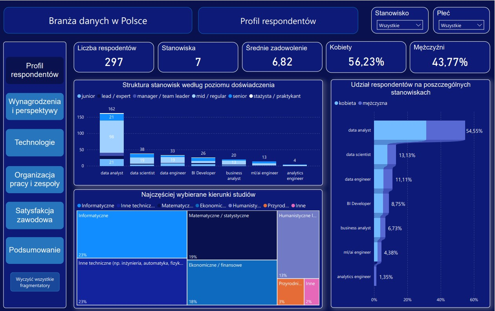
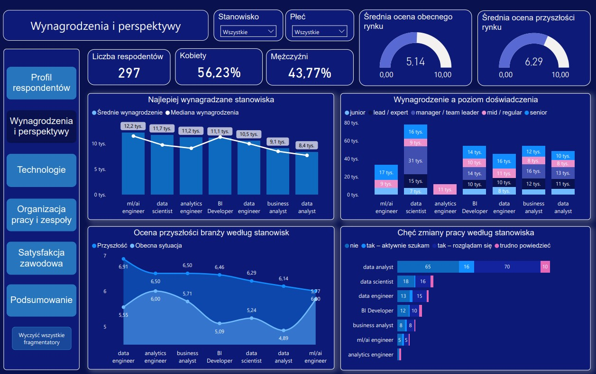
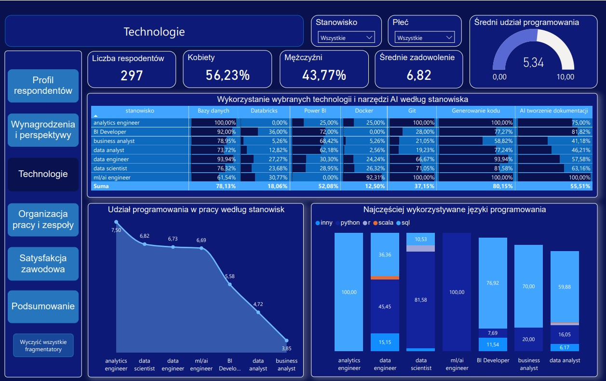
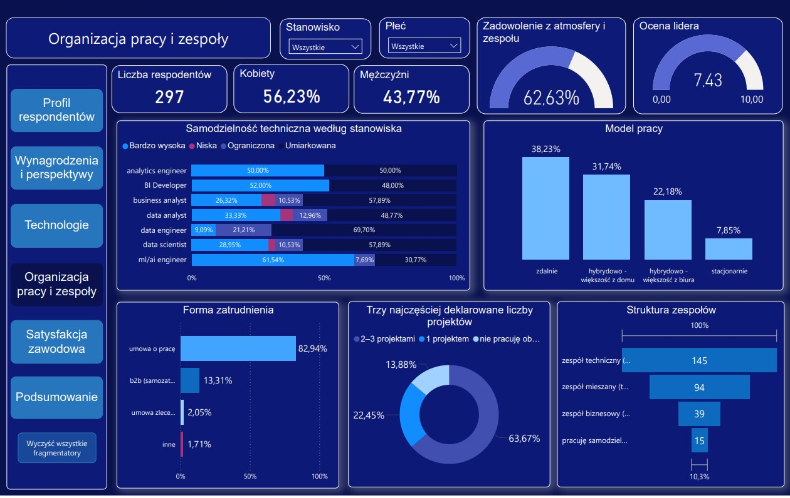
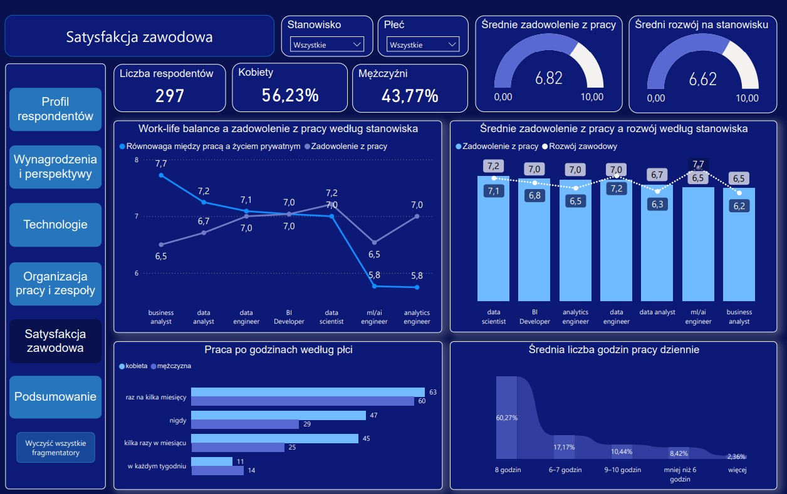
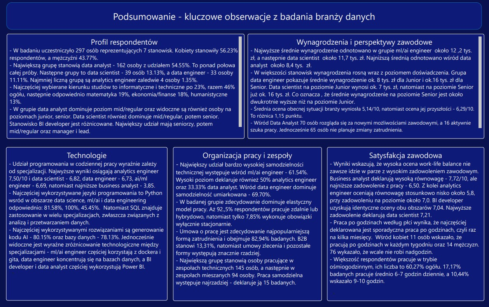

# Analiza rynku pracy w branży danych w Polsce
### Wynagrodzenia, przyszłość, kompetencje, technologie i satysfakcja zawodowa

## Stanowiska w branży danych pod kątem analizy wynagrodzeń, kompetencji i satysfakcji zawodowej 
### Cel projektu
Projekt przedstawia analizę danych ankietowych dotyczących rynku pracy w branży danych w Polsce. Jego celem jest porównanie różnych stanowisk zawodowych pod względem wynagrodzeń, wykorzystywanych technologii, kompetencji, organizacji pracy, satysfakcji zawodowej oraz perspektyw rozwoju.

Dane wykorzystane w projekcie pochodzą z platformy **Crappy Data Club**, która przeprowadziła badanie ankietowe pod nazwą **“Wielka Ankieta Branży Data”**.
Analiza została przeprowadzona na podstawie odpowiedzi 297 respondentów. Badana próba nie jest równomierna pod względem liczebności poszczególnych stanowisk, dlatego wyniki należy interpretować z uwzględnieniem tej charakterystyki. Nie należy traktować ich jako reprezentatywnego obrazu całego rynku pracy w Polsce.

Projekt obejmuje dwa główne obszary: analizę danych z wykorzystaniem języka SQL oraz prezentację i interpretację wyników w dashboardzie Power BI.

Główne pytanie badawcze
- Jak różnią się warunki pracy, kompetencje i doświadczenia zawodowe osób zajmujących poszczególne stanowiska w branży danych w Polsce?

W ramach projektu przeanalizowano między innymi:
- strukturę stanowisk, wykształcenia i doświadczenia zawodowego;
- wynagrodzenia w zależności od stanowiska i poziomu seniority;
- wykorzystywane języki programowania, technologie i narzędzia;
- organizację pracy, formy zatrudnienia i strukturę zespołów;
- satysfakcję zawodową, możliwości rozwoju i work-life balance;
- ocenę obecnej i przyszłej sytuacji branży oraz plany zawodowe respondentów.

### Dokumentacja projektu
Szczegółowy opis realizacji projektu, obejmujący zastosowane zapytania SQL, wyniki przeprowadzonych analiz oraz dodatkowe wnioski, został przedstawiony w osobnym dokumencie.

Dokumentacja zawiera między innymi:
- opis struktury i przygotowania danych,
- wykorzystane zapytania SQL wraz z ich przeznaczeniem,
- wyniki analiz w postaci tabel i zestawień,
- interpretację uzyskanych rezultatów.

Plik: )

### Dashboard Power BI
Główną częścią preojektu jest dashboard, który został podzielony na sześć obszarów tematycznych:
1. Profil respondentów - struktura stanowisk, płci, wykształcenia i doświadczenia.
2. Wynagrodzenia i perspektywy zawodowe - wynagrodzenia, ocena sytuacji branży i plany zmiany pracy.
3. Technologie - wykorzystywane technologie, języki programowania i narzędzia.
4. Organizacja pracy i zespoły - model pracy, zatrudnienie, projekty i samodzielność techniczna.
5. Satysfakcja zawodowa - zadowolenie z pracy, możliwości rozwoju, work-life balance i czas pracy.
6. Podsumowanie - najważniejsze wyniki i wnioski z przeprowadzonych analiz.

Plik: )

### Przegląd poszczególnych sekcji dashboardu
1. Profil respondentów
   
Strona przedstawia strukturę badanej próby według stanowiska, płci, poziomu doświadczenia oraz wykształcenia respondentów. Pozwala określić, jakie grupy zawodowe dominują w badaniu i jaki jest ich profil edukacyjny.

2. Wynagrodzenia i perspektywy

W tej sekcji przechodzimy od struktury stanowisk do jednego z najważniejszych aspektów pracy w branży danych, czyli wynagrodzeń. Warto sprawdzić, czy wysokość zarobków różni się w zależności od stanowiska, a także czy poziom seniority ma związek z wysokością wynagrodzenia. W tej części również są przedstawione analizy, jak osoby pracujące w branży danych postrzegają jej przyszłość oraz jakie mają plany dotyczące swojej kariery zawodowej.

3. Technologie

Strona przedstawia technologie, narzędzia i języki programowania wykorzystywane przez osoby pracujące w branży danych. Umożliwia porównanie profili technologicznych poszczególnych stanowisk oraz określenie, jak duże znaczenie programowanie odgrywa w codziennej pracy różnych specjalistów.

4. Organizacja pracy i zespoły

Strona przedstawia sposób organizacji pracy osób zatrudnionych w branży danych oraz charakterystykę środowiska zespołowego. Umożliwia porównanie modeli pracy, form zatrudnienia i sposobu realizacji projektów, a także ocenę poziomu samodzielności technicznej w poszczególnych specjalizacjach.

5. Satysfakcja zawodowa

W tej części przedstawione są analizy poziomu zadowolenia zawodowego osób pracujących na różnych stanowiskach.  Celem jest sprawdzenie, czy satysfakcja z pracy różni się w zależności od stanowiska oraz czy mogą mieć na nią wpływ takie czynniki jak równowaga między życiem zawodowym a prywatnym i częstotliwość pracy po godzinach.

6. Podsumowanie

Ostatnia strona dashboardu przedstawia najważniejsze wyniki i obserwacje wynikające z przeprowadzonych analiz. Jej celem jest zebranie kluczowych informacji dotyczących rynku pracy.

### Najważniejsze obserwacje
- W badanej próbie dominują osoby pracujące na stanowisku data analyst - 54.55%.
- Wynagrodzenia różnią się między stanowiskami i poziomami doświadczenia zawodowego.
- Najwyższe średnie wynagrodzenie odnotowano wśród ml/ai engineerów z wartością ok. 12.2 tys. zł, jednak liczebność tej grupy była niewielka.
- Python i SQL należą do najważniejszych języków programowania wykorzystywanych w branży danych.
- Przeważają zdalne i hybrydowe modele pracy.
- Średnia ocena zadowolenia z pracy wynosi 6.82/10, a ocena możliwości rozwoju 6.62/10.
- Respondenci oceniają przyszłość branży lepiej - 6.29 niż jej obecną sytuację - 5.14.
- Wykorzystanie narzędzi AI do generowania kodu zadeklarowała większość respondentów około 80%.
- Najczęściej respondenci pracują nad 2-3 projektami jednocześnie, deklaracja wyniosła 63.67% ogółu.
- W badanej próbie dominują umowy o pracę, a zespoły techniczne stanowią najczęściej wskazywany typ zespołu.
- Większość respondentów deklaruje umiarkowany lub bardzo wysoki poziom samodzielności technicznej.
- Większość badanych pracuje około 8 godzin dziennie, a praca po godzinach najczęściej ma charakter sporadyczny.
- Najwyższe średnie zadowolenie z pracy zadeklarowali data scientiści - ok. 7.2/10, natomiast najniższe business analyst i ml/ai engineerzy około 6.5.
